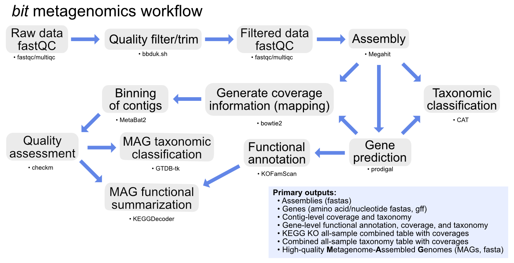

# [bit](https://github.com/AstrobioMike/bit) workflows
The [snakemake](https://snakemake.github.io/) workflows that come with _bit_ are run with `bit run-wf` (metagenomics, magrec, amplicon) or as commands of their own (`bit characterize-genomes`, `bit classify-seqs`, `bit dl-sra-reads`). Unless noted, what's described here holds for all of them. There is nothing to download or edit first anymore, as the settings are all given on the command line (unless you want to download the full workflow for records/customization, available for the large ones with --get-workflow).

* [**Running a workflow**](#running-a-workflow)
  * [Settings and help menus](#settings-and-help-menus)
  * [Config files](#config-files)
  * [Jobs, threads and extra snakemake options](#jobs-threads-and-extra-snakemake-options)
  * [Saving a copy of a workflow to modify](#saving-a-copy-of-a-workflow-to-modify)
  * [Reference databases](#reference-databases)
* [**metagenomics**](#metagenomics)
* [**magrec**](#magrec)
* [**amplicon**](#amplicon)
* [**characterize-genomes**](#characterize-genomes)
* [**classify-seqs**](#classify-seqs)
* [**dl-sra-reads**](#dl-sra-reads)
* [**Version info**](#version-info)

---

## Running a workflow
_bit_ should be installed via conda as described [here](https://github.com/AstrobioMike/bit?tab=readme-ov-file#conda-install).

```bash
bit run-wf metagenomics -r reads-dir/
bit run-wf magrec -r reads-dir/ -a assemblies-dir/
bit run-wf amplicon -r reads-dir/ --target-region 16S
bit characterize-genomes -g genomes-dir/
bit classify-seqs -f contigs.fasta
bit dl-sra-reads -a target-sra-accs.txt
```

The reference databases these use are kept in one directory, set once with `bit data locations set` (see [Reference databases](#reference-databases)).

Everything a run writes goes in its output directory (`-o`, by default `<workflow>-outputs/`). Along with the results, that holds:

- `config.yaml` – every setting the run used
- `command-execution-info.txt` – the command as it was entered
- `logs/` – the log files of the steps run
- `benchmarks/` – time and memory used by each step, combined in `ALL-benchmarks.tsv`

Running the same command again picks up where a stopped run left off (add `--rerun-incomplete` if it was interrupted mid-step). `--dry-run` shows what would be run without running anything.

The programs each workflow uses are installed as conda environments the first time they are needed (inside the _bit_ environment by default), and re-used afterwards.

### Settings and help menus
- `-h` shows the settings most runs need (e.g., `bit run-wf metagenomics -h`, `bit dl-sra-reads -h`)
- `-H` shows every setting the workflow has, with defaults

### Config files
Settings can also be given in a yaml file with `-c`, e.g., the `config.yaml` written by a previous run. Anything given on the command line takes precedence over the file, and the file over the defaults.

```bash
bit run-wf metagenomics -c previous-run/config.yaml -o new-run/ --skip-binning
```

### Jobs, threads and extra snakemake options
`-j` sets how many jobs may run at once, and each workflow's `-t` sets the threads per job, so up to `-j` x `-t` cores are used. With `bit run-wf`, anything after a `--` is passed to snakemake as-is, e.g.:

```bash
bit run-wf metagenomics -r reads-dir/ -j 4 -t 8 -- --keep-going
```

To submit jobs to a scheduler such as slurm, install snakemake's [executor plugin](https://snakemake.github.io/snakemake-plugin-catalog/) for it in the _bit_ environment and pass its options the same way (e.g., `-- --executor slurm --default-resources slurm_account=<account>`). The memory requests listed in each workflow's `-H` menu are what get passed along for each job.

### Memory
On one machine, jobs are only started while the memory they need (the settings under "Memory" in the `-H` menu) fits in the machine's memory together, so steps that need a lot, such as GTDB-Tk, wait for room rather than all starting at once. `--memory <GB>` sets a smaller total, e.g. on a shared machine. If a step of the run needs more than that total, the run stops before anything starts and says which step. (Through a cluster executor or profile, none of this applies: each job's memory setting is its request to the scheduler.)

megahit is the exception: its memory setting (32 GB by default) is only the most it may use, so it's kept within the total, and an assembly that fails is retried twice with double the memory each time (64 GB, then 128 GB, never more than the total). Most metagenomes need well under 32 GB (a deep 106M read-pair gut sample peaked at 27 GB); very diverse samples such as soils can need more.

GTDB-Tk (in the binning of the metagenomics and magrec workflows, and in `bit characterize-genomes`) needs about 150 GB of memory for bacterial genomes and only runs on Linux: one of the programs it depends on (pplacer) isn't built for macOS. On a Mac, the MAGs and genomes get their taxonomy from bit-tax-db instead (each classified as a whole, as eukaryotic genomes are; see [characterize-genomes](#characterize-genomes)), so the tax db is set up there in place of GTDB-Tk's reference, and a note says so.

### Saving a copy of a workflow to modify
(`bit run-wf` only.) `--get-workflow <DIR>` writes a complete, standalone copy of a workflow (its Snakefile, rule files, conda environment files, scripts, and a `config.yaml` holding the settings given) and stops there. The directory has to be new or empty (nothing already there is written over; there is no `-F/--force-overwrite` for the workflows, and running one again with the same output directory carries on from where it stopped). The copy can be edited freely, and run either way:

```bash
bit run-wf metagenomics -r reads-dir/ --get-workflow my-metagenomics-wf/

bit run-wf metagenomics --workflow-dir my-metagenomics-wf/ -o outputs/
# or, from within my-metagenomics-wf/
snakemake --software-deployment-method conda --conda-prefix ${CONDA_PREFIX}/envs --cores 16 -p
```

### Reference databases
The reference databases are all kept in one directory, each in its own subdirectory (named for its version) with a `DB-INFO.txt` noting where it came from and when. Set the directory once with `bit data locations set` (it's stored in the `BIT_REF_DBS_DIR` variable of the conda environment; the databases can take a few hundred GB together, so pick somewhere with room), or give one for a run with `-d/--ref-dbs-dir`.

Before a run starts, any database it needs that isn't there yet is downloaded and set up, with a progress bar. Downloads are checked against the md5 their source publishes where there is one, and pick up where they left off if interrupted. They can also be set up on their own:

| database | `bit data get ...` | used by | download |
|---|---|---|---|
| bit-tax-db (taxonomy) | `tax-db` | classify-seqs, metagenomics, characterize-genomes `--euk`; on a Mac also the MAG and genome taxonomy | ~97 GB (~160 GB unpacked) |
| CheckM2 | `checkm2-db` | metagenomics (binning), magrec, characterize-genomes | ~1.7 GB |
| GTDB-Tk | `gtdbtk-db` | metagenomics (binning), magrec, characterize-genomes (Linux only) | ~61 GB |
| KOFamScan | `kofamscan-db` | metagenomics | ~1.6 GB |
| EukCC | `eukcc-db` | characterize-genomes `--euk` | ~6.3 GB |
| DECIPHER training sets | `amplicon-refs` | amplicon | ~575 MB |

To set up just what a run would use without running anything else (e.g., somewhere with internet access before submitting jobs), add `--setup-dbs-only`; the inputs aren't needed then:

```bash
bit run-wf metagenomics --setup-dbs-only
bit characterize-genomes --euk --setup-dbs-only
```

For the amplicon workflow, if no reference-database directory is set its references are downloaded into the output directory of each run instead.

Before downloading anything (a database, or the conda environments the first time a workflow is run), a run checks that it can reach the sites it needs, and stops right away with a message if it can't, saying whether there is no internet connection at all or which site isn't answering. If databases are missing, the message lists them with the command to get each one, so they can be set up on another machine that has internet access (`bit data get <name> -d <dir>`), copied over (or put somewhere both machines can see), and pointed to with `BIT_REF_DBS_DIR` or `-d/--ref-dbs-dir`. A run that already has everything it needs doesn't check, and works without a connection.

A saved copy of a workflow (`--get-workflow`) run with snakemake directly doesn't download anything: if a database it needs is missing, it stops and gives the `bit data get` command to run.

---

## metagenomics

<p align="center">
<a href="../images/bit-metagenomics-overview.pdf"></a>
</p>

An assembly-based workflow for short-read metagenomes, through to combined taxonomy and KO coverage tables across samples, and recovery and characterization of bacterial/archaeal MAGs. Each sample is assembled on its own (there is no co-assembly).

  - [fastqc](https://www.bioinformatics.babraham.ac.uk/projects/fastqc/)/[multiqc](https://multiqc.info/) for read-quality assessment and summarization
  - [bbduk](https://jgi.doe.gov/data-and-tools/software-tools/bbtools/bb-tools-user-guide/bbduk-guide/) for read quality-filtering and trimming
  - [megahit](https://github.com/voutcn/megahit) for assembly
  - [prodigal](https://github.com/hyattpd/Prodigal) for gene prediction
  - [bowtie2](https://github.com/BenLangmead/bowtie2) for read mapping, and `bit cov-stats` for coverages
  - [KOFamScan](https://github.com/takaram/kofam_scan) for functional annotation
  - taxonomic classification of genes and contigs
  - [metabat2](https://bitbucket.org/berkeleylab/metabat/src) for binning of contigs
  - [checkm2](https://github.com/chklovski/CheckM2#checkm2) for estimating quality of bacterial/archaeal bins
  - [GTDB-tk](https://github.com/Ecogenomics/GTDBTk#gtdb-tk) for assigning taxonomy of bacterial/archaeal MAGs
  - [dRep](https://github.com/MrOlm/drep) for dereplicating the MAGs of all samples, to which every sample's reads are then mapped (bowtie2, `bit cov-stats`) for MAG-by-sample tables
  - [KEGG-decoder](https://github.com/bjtully/BioData/tree/master/KEGGDecoder) for functionally summarizing recovered MAGs

The read files are found in the reads directory the same way `bit assemble` finds them: paired files by their R1/R2 designations, the sample ID being what comes before it. All samples found are processed unless a file of sample IDs is given with `-s`. Add `--single-end` for single-end reads, and `--skip-binning` to stop before binning and MAG recovery.

`--binning-only` goes from read QC and assembly straight to binning and MAG recovery: no gene calls, KO annotation, contig and gene taxonomy, combined coverage tables, or KEGG-Decoder (so it needs only the CheckM2 and GTDB-Tk references). The binning and MAG steps are the same as [magrec](#magrec)'s, which starts from assemblies made already.

### Outputs

- **`fastqc-outputs/`**
  - multiqc summaries of fastqc reports for input and filtered reads
- **`filtered-reads/`**
  - quality-filtered reads
- **`assemblies/`**
  - assemblies in fasta format
  - a tab-delimited table with assembly summary metrics ("assembly-summaries.tsv")
- **`predicted-genes/`**
  - predicted genes in fasta, faa, and gff format
- **`read-mapping/`**
  - bam files from mapping reads to their respective assemblies, the mapping summary info, and the depth/coverage info used with metabat for binning
- **`annotations-and-taxonomy/`**
  - contig-level coverages and taxonomy files, and gene-level coverages, KO annotations, and taxonomy files
- **`bins/`**
  - bins recovered in fasta format
  - an overview summary table ("bins-overview.tsv"), including summary metrics and checkm2 quality estimates
- **`MAGs/`**
  - bins that pass the quality thresholds (by default >= 90% estimated completion and <= 10% estimated redundancy; see `--min-completion` and `--max-redundancy`) in fasta format
  - an overview summary table ("MAGs-overview.tsv"), including GTDB-assigned taxonomy
  - KO annotations per MAG ("MAG-level-KO-annotations.tsv")
  - MAG-level KO summaries via KEGGDecoder ("MAG-KEGG-Decoder-out.html" and "MAG-KEGG-Decoder-out.tsv")
  - the MAGs of all samples dereplicated at 95% average nucleotide identity (about the species level; see `--derep-ani`), each MAG listed with the one standing for it, picked by checkm2's estimates ("dereplicated-MAGs.tsv")
  - MAG-by-sample tables of the dereplicated MAGs, from mapping each sample's reads to all of them together (so a read goes to the MAG it matches best), counting only reads mapped at >= 95% identity (see `--MAG-min-read-pid`; reads of organisms without a MAG otherwise land on their closest relative):
    - detection: the percent of the MAG's bases covered by at least one read ("MAG-detection-by-sample.tsv")
    - the percent of the sample's reads that mapped to it, mates counted separately ("MAG-percent-of-reads-by-sample.tsv")
    - mean coverage ("MAG-coverage-by-sample.tsv")
- **`combined-outputs/`**
  - combined contig-level taxonomic coverages across samples
  - combined gene-level KO coverages across samples
    - for each of those there is also a version normalized to coverage per million "CPM", where it's like percent except instead of being out of 100, it is out of 1,000,000
      - these CPM tables might be useful for some visualizations, but that type of conversion is typically not suitable for any statistics or hierarchical clustering/ordination
- **`processing-overview.tsv`**
  - per sample: whether each major step produced anything, the number of bins and MAGs, and how much of the sample's reads its assembly, bins and MAGs account for (the percent of its reads that mapped to the assembly's contigs, to the contigs in its bins, and to those in its MAGs; reads counted individually, so each mate of a pair counts once)

---

## magrec
MAG recovery from reads and assemblies made already: the binning and MAG steps of the metagenomics workflow, on their own.

  - [bowtie2](https://github.com/BenLangmead/bowtie2) for mapping the reads to the assemblies
  - [metabat2](https://bitbucket.org/berkeleylab/metabat/src) for binning
  - [checkm2](https://github.com/chklovski/CheckM2#checkm2) for estimating quality of the bins
  - [GTDB-tk](https://github.com/Ecogenomics/GTDBTk#gtdb-tk) for assigning taxonomy of the MAGs (bit-tax-db on a Mac)
  - [dRep](https://github.com/MrOlm/drep) for dereplicating the MAGs of all assemblies, to which every sample's reads are then mapped for the MAG-by-sample tables

The reads (`-r`) are found as for the metagenomics workflow and used as given, so they should be quality-filtered already (as they were for assembling). The assemblies (`-a`) are either:

  - a directory holding one assembly per sample, named `<sample ID><extension>` (`-x`, ".fasta" by default; e.g. `-x -assembly.fasta` for the metagenomics workflow's assemblies), each binned with its own sample's reads; or
  - a single co-assembly fasta file: every sample's reads are mapped to it, and it is binned with the coverage of all of them

In the run's copy of each assembly, every contig name gets the assembly's name in front of it (e.g. "sample-1_k141_77", or the co-assembly's file name without its extension), so contigs of different assemblies can't share a name.

### Outputs
- **`assemblies/`**: the run's copies of the assemblies, and their summary metrics ("assembly-summaries.tsv")
- **`read-mapping/`**: bam files of each sample's reads mapped to its assembly (or the co-assembly), the mapping summary info, and the depth info used with metabat
- **`bins/`** and **`MAGs/`**: as for the [metagenomics](#metagenomics) workflow (without the KO annotations and KEGG-Decoder summaries)
- **`processing-overview.tsv`**: per sample, the number of bins and MAGs of the assembly its reads were mapped to, and the percent of its reads that mapped to that assembly, its bins and its MAGs

---

## amplicon
Processes short-read amplicon data (16S/18S/ITS) through to ASVs, a count table, and a taxonomy table.

  - [fastqc](https://www.bioinformatics.babraham.ac.uk/projects/fastqc/)/[multiqc](https://multiqc.info/) for read-quality assessment and summarization
  - [cutadapt](https://cutadapt.readthedocs.io/en/stable/) for primer trimming
  - [dada2](https://www.bioconductor.org/packages/release/bioc/html/dada2.html) for quality filtering and ASV inference
  - [decipher](https://decipher.codes/) for taxonomic classification of ASVs with the following [databases](https://decipher.codes/Downloads.html)
    - SILVA SSU r138.2 for 16S
    - PR2 18S v4.13 for 18S
    - UNITE 2025 for ITS

The primers are given with `--f-primer` and `--r-primer` as cutadapt takes them (a leading `^` anchors a primer to the start of the read). By default each read is also checked for the reverse complement of the other primer towards its end, as happens when reads are longer than the amplicon, and reads in which the primers aren't found are discarded; see `--primers-not-linked` and `--keep-untrimmed` in the `-H` menu, and `--skip-primer-trimming` if the primers are already removed.

> If you'd like a small test dataset to run, `bit data get test-data amplicon` grabs 2 small amplicon samples.

### Outputs

- **`fastqc-outputs/`**
  - multiqc summaries of fastqc reports for input and filtered reads
- **`trimmed-reads/`**
  - primer-trimmed reads, the combined cutadapt log, and read counts before and after (if primers were trimmed by the workflow)
- **`filtered-reads/`**
  - quality-filtered reads
- **`final-outputs/`**
  - read-count-tracking.tsv
  - ASVs.fasta
  - counts.tsv
  - taxonomy.tsv
  - taxonomy-and-counts.tsv
  - taxonomy-and-counts.biom

---

## characterize-genomes
Summarizes genome assemblies in one table: assembly summary stats, estimated quality, and taxonomy.

  - `bit summarize-assembly` for assembly summary stats
  - [checkm2](https://github.com/chklovski/CheckM2#checkm2) for estimating quality of bacteria/archaea
  - [GTDB-tk](https://github.com/Ecogenomics/GTDBTk#gtdb-tk) for assigning taxonomy of bacteria/archaea
  - [eukcc](https://github.com/Finn-Lab/EukCC#eukcc) for estimating quality of eukarya (with `--euk`)
  - the same taxonomy as `bit classify-seqs` (bit-tax-db) for eukarya (with `--euk`), each genome classified as a whole: from the k-mers of all its contigs together when it shares enough of them with a reference genome, otherwise from all its proteins (as called by eukcc)

The genomes directory should hold uncompressed fasta files, whose extension is given with `-x` (".fasta" by default).

### Outputs
The output directory holds `genome-summaries.tsv`, one row per genome, in the same format as the metagenomics workflow's MAG overview table: assembly summary stats, estimated completeness and redundancy, and the taxonomy by rank ("NA" where there is none), ordered by taxonomy, e.g.:

```
Assembly         Total contigs  Total length  GC content  Maximum contig length  N50     L50  Num. contigs >= 10000  Num. contigs >= 50000  Num. contigs >= 100000  est. completeness  est. redundancy  domain    phylum          class          order             family           genus          species
GCF_000336935.1  109            4199784       63.45       402253                 105665  10   52                     26                     11                      98.88              2.24             Archaea   Halobacteriota  Halobacteria   Halobacteriales   Halococcaceae    Halococcus     Halococcus salifodinae
GCF_022743825.1  46             2095693       41.87       134644                 83489   10   39                     16                     7                       96.06              0.06             Bacteria  Bacillota       Negativicutes  Veillonellales    Veillonellaceae  Veillonella_A  Veillonella_A seminalis
```

The full outputs of the programs run are removed once the table is made unless `--keep-all-files` is given.

---

## classify-seqs
Assigns taxonomy to each sequence in one or more fasta files, e.g. assembled contigs, or high-quality long reads such as PacBio HiFi. The reference ([bit-tax-db](https://github.com/AstrobioMike/bit-tax-db), `bit data get tax-db`) holds GTDB bacteria and archaea and NCBI eukaryotes and viruses.

  - [prodigal](https://github.com/hyattpd/Prodigal) for gene prediction
  - [DIAMOND](https://github.com/bbuchfink/diamond) for searching the genes against the reference proteins (one search for all inputs)
  - [sourmash](https://sourmash.readthedocs.io/) for sampling each sequence's k-mers (k=31), compared against those of the reference genomes

`-f` takes one fasta file, several (space-delimited), or a directory holding them (uncompressed; extensions .fasta, .fa, .fna, .fas or .fsa). Each sequence is assigned a species when a reference genome holds enough of its sampled k-mers (`--min-containment`, 0.65 by default, which is roughly 98.6% nucleotide identity); otherwise its taxonomic assignment comes from its genes: each gene is assigned the lowest common ancestor of its best protein hits, limited by how similar they are (species, genus and family need at least 95%, 80% and 60% identity by default; see `--identity-cutoffs`), and the sequence takes the deepest assignment its genes agree on. Genes are only searched for the sequences their k-mers didn't assign, so when every sequence gets a species from its k-mers there is no protein search at all.

`--genomes` classifies each fasta file as a whole instead (a genome, MAG or bin): the sampled k-mers of all its contigs are pooled, and all its genes vote together. A whole genome has thousands of sampled k-mers, so a lower share is a solid signal: a species is assigned from k-mers when a reference genome holds at least 40% of them (`--genome-min-containment`). That value made no wrong species call for 46 benchmark genomes whose own species was hidden from the reference (sister species reached 37%), while calling 45 of the 46 right with it present; 20% (about 95% identity) mixed up close species. The same whole-genome classification gives the taxonomy of eukaryotic genomes in `bit characterize-genomes --euk`, and of MAGs and genomes on macOS, where GTDB-Tk doesn't run.

### Outputs
With `--genomes`, one table, `genome-taxonomies.tsv`, with a row per input fasta (its name, the taxonomy by rank, and the evidence). Otherwise one table per input fasta, `<input name>-tax.tsv`, in the output directory, with one row per sequence: its ID, the taxonomy by rank ("NA" below the deepest rank assigned), and the evidence the taxonomic assignment came from ("k-mers", "proteins" or "none"), e.g.:

```
seq_id     domain    phylum           class                order              family              genus          species                 evidence
contig_1   Bacteria  Pseudomonadota   Gammaproteobacteria  Enterobacterales   Enterobacteriaceae  Escherichia    Escherichia coli        k-mers
contig_2   Bacteria  Bacillota        Bacilli              Lactobacillales    Streptococcaceae    Streptococcus  NA                      proteins
```

The called genes, search results and sketches are removed once the tables are made unless `--keep-all-files` is given.

---

## dl-sra-reads
Downloads reads from [NCBI's SRA](https://www.ncbi.nlm.nih.gov/sra) in gzipped fastq format given run accessions (those starting with SRR, ERR, or DRR), using prefetch and fasterq-dump. The accessions are given in a single-column file with `-a`, and the fastq files are written to `fastq-files/` in the output directory.

### Combining runs that belong to the same sample
Sometimes multiple runs belong to the same sample but still need to be downloaded independently. To have them combined, give the accessions file two columns, the wanted sample name and then the run accession, e.g.:

```
Sample-1    SRR123456
Sample-1    SRR123457
Sample-2    SRR123458
```

Here the SRR123456 and SRR123457 files are combined into "Sample-1_R1.fastq.gz" and "Sample-1_R2.fastq.gz" (or "Sample-1.fastq.gz" if single-end), and Sample-2's are just renamed. The runs' own files are removed once combined. Sample names can't start with SRR, ERR, or DRR, as their files would be confused with those of the runs.

---

## Version info
The workflows are part of the _bit_ package and share its version (`bit -v`). The versions of the programs they use are in the conda environment files in [bit/smk/envs/](../bit/smk/envs). The change logs from when the workflows were versioned separately are [here](CHANGELOG-standalone-versions.md).
